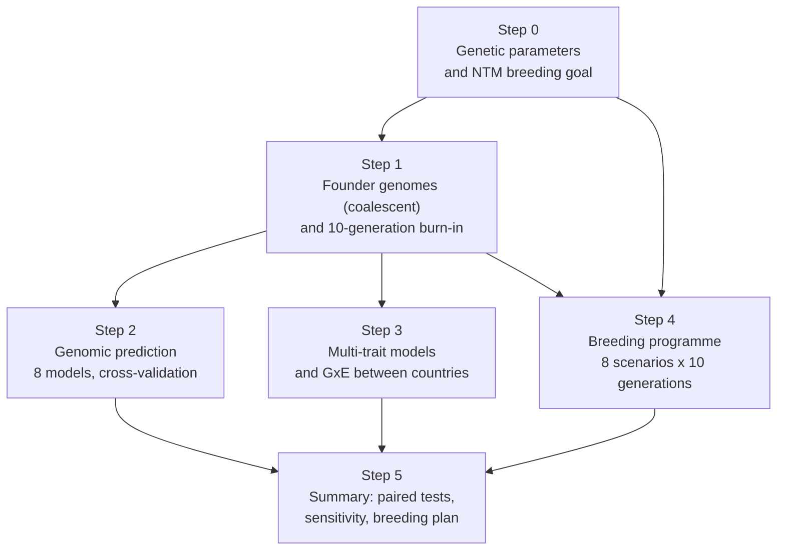

# Can genomic selection improve nitrogen use efficiency in dairy cattle?

A reproducible simulation pipeline in R Markdown (AlphaSimR) that models a Nordic-style dairy breeding programme:
Holstein (HOL), Red Dairy Cattle (RDC) and Jersey (JER) in single-breed herds across Denmark, Sweden, Finland and Germany.

It asks one question: **if nitrogen use efficiency (NUE) is added to the Nordic Total Merit (NTM) breeding goal, how much NUE is gained, and what does it cost in total merit, methane and inbreeding?**

> **This is a simulation.** Genetic parameters come from published studies, but the population, genomes and phenotypes are simulated.
> Results show what the design and the published parameters imply, not what real Nordic data would show.

## Contents

- [Main results](#main-results)
- [The pipeline at a glance](#the-pipeline-at-a-glance)
- [Step by step](#step-by-step)
  - [Step 0: genetic parameters and breeding goal](#step-0-genetic-parameters-and-breeding-goal-00_genetic_parametersrmd)
  - [Step 1: founder genomes and burn-in](#step-1-founder-genomes-and-burn-in-01_founders_burninrmd)
  - [Step 2: genomic prediction](#step-2-genomic-prediction-02_genomic_predictionrmd)
  - [Step 3: multi-trait models and GxE](#step-3-multi-trait-models-and-gxe-03_multitrait_gxermd)
  - [Step 4: the breeding programme](#step-4-the-breeding-programme-04_breeding_programrmd)
  - [Step 5: summary and statistics](#step-5-summary-and-statistics-05_summaryrmd)
- [Sensitivity analyses](#sensitivity-analyses)
- [Limitations](#limitations)
- [How to run](#how-to-run)
- [Repository layout](#repository-layout)
- [Key references](#key-references)
- [Licence](#licence)

## Main results

Responses are over 10 generations of selection, in founder genetic standard deviations (SD).
Differences are paired within replicate (10 replicates, each with its own founder population); p-values are from paired t-tests and are not corrected for multiple testing.

| Question | Result |
|---|---|
| Does NTM alone improve NUE? | Yes, by 3.3 to 3.4 SD in all breeds, but only through NUE's genetic correlations with yield. With those correlations set to 0, the gain is about 0. |
| What does an explicit NUE weight add? | Weight 0.35: HOL +1.08, JER +0.94, RDC +0.82 SD of NUE (all p <= 0.003). Weight 0.75: +0.95 to +1.43 SD. |
| What does the NUE weight cost in NTM? | Too small to detect at weight 0.35: theory predicts about 1.3 to 1.6 index units, and the replicate SD of the difference is 5 to 6 units. |
| What happens to methane? | CH4 rises 1.6 to 2.1 SD under NTM alone. A CH4 weight of -0.5 lowers it by 1.4 to 1.6 SD, at EUR 28 to 39 per cow-year. |
| Does selecting against milk urea (MUN) help NUE? | No. MUN falls 1.2 to 1.4 SD, NUE does not change, and it costs EUR 31 to 50 per cow-year. |
| Can inbreeding be controlled? | Unconstrained genomic selection: 1.8 to 2.2% per generation. Optimum contribution selection: 0.7 to 1.0%, at EUR 30 to 38 per cow-year. |
| Is there genotype x country interaction? | Could not be estimated reliably at this sample size (see Step 3). |

Full tables: [`reports/05_summary.html`](reports/05_summary.html) (download and open in a browser) and [`results/NUE_replicate_results.xlsx`](results/NUE_replicate_results.xlsx).

## The pipeline at a glance



| | |
|---|---|
| Breeds | Holstein, Red Dairy Cattle, Jersey |
| Countries | Denmark, Sweden, Finland, Germany |
| Herds | 40 single-breed herds, sized from published CFIT 3D-camera herd numbers |
| Traits (11) | Milk, protein and fat yield; Saved Feed; somatic cell score; resilience (LnVar); calving interval; longevity; milk urea nitrogen; NUE; methane |
| Genome | 29 chromosomes, 10,005 SNP, 600 founders per breed |
| Replicates | 10 per main scenario (independent founders), 5 per sensitivity set |
| Software | R 4.3.3, AlphaSimR 2.1.0, sommer 4.5.12, BGLR 1.1.4, rrBLUP 4.6.3, nadiv 2.18.0 |

## Step by step

Each step is one R Markdown file. It reads only the outputs of earlier steps and writes a self-contained HTML report (in [`reports/`](reports)).

### Step 0: genetic parameters and breeding goal (`00_genetic_parameters.Rmd`)

**What it does.** Collects every heritability and genetic correlation with its source, builds a valid correlation matrix, and defines the selection indices.

**Why.** A simulation is only as good as its inputs. Every value is either cited or labelled as not estimated.

**Key choices.**

- **Heritabilities** are breed-specific where published: yield and fertility from the NAV routine evaluation (May 2024); MUN from Buitenhuis & Poulsen (2023); NUE 0.13 from Chen et al. (2021); CH4 0.175 from Schneider et al. (2025); Saved Feed 0.23 from Lidauer et al. (2023).
- **Genetic correlations**: 40 of 55 trait pairs have a published source. Rules: index-based values only from Nordic breeds, genuine estimates from European studies, recent over old. Evidence for every pair is in [`results/rg_evidence.xlsx`](results/rg_evidence.xlsx).
- **Unsourced pairs** take the values implied by *weighted bending* (Jorjani et al. 2003), which makes the matrix positive definite while moving published values by at most about 0.015. These values are not estimates.
- **NUE correlations** (milk 0.52, protein 0.80, MUN -0.12) all come from one study of grazing Irish cows (Tavernier et al. 2024). This is the pipeline's weakest input, so it gets its own sensitivity analysis.
- **Breeding goal**: NTM sub-index weights (May 2026) for the sub-indices that have a simulated trait (64% of NTM weight for HOL and RDC, 72% for JER). NUE has no published economic value, so weights of 0.35 (equal to Saved Feed) and 0.75 are tested.

**Writes** `params/*.csv` and `params/RG_matrix.rds`.

### Step 1: founder genomes and burn-in (`01_founders_burnin.Rmd`)

**What it does.** Creates founder genomes for three breeds, assigns correlated genetic effects for the 11 traits, places cows in herds, and runs 10 generations of historical selection.

**Why.** Genomic selection depends on linkage disequilibrium and family structure. The start population must look like a selected cattle population, not a random sample.

**Key choices.**

- **Coalescent founders** (MaCS, AlphaSimR cattle demography, current Ne = 90; MacLeod et al. 2013), extended to three breeds: the HOL and RDC lineages join 30 generations ago, JER 50. The split times are not calibrated to observed F<sub>ST</sub>.
- **29 chromosomes** (bovine autosomes) so that genome length is realistic; **10,005 SNP** to fit a 2-core, 6 GB machine. A 50k version is in [`hpc/`](hpc).
- **Single-breed herds**, as on CFIT farms. Breed is therefore nested in herd, and later models drop breed as a fixed effect.
- **Burn-in** selects on milk and protein yield, to reproduce historical yield selection.
- **Replicates** use seed 20261031 + replicate number, each with new founders.

**Writes** `burnin_state.rds`, `phenotypes.csv`, `pedigree.csv`, `trend_burnin.csv`.

### Step 2: genomic prediction (`02_genomic_prediction.Rmd`)

**What it does.** Compares eight evaluation models for NUE, MUN, Saved Feed and CH4: pedigree BLUP, GBLUP, single-step GBLUP (pooled, and with breed metafounders), weighted single-step, rrBLUP, BayesA and BayesB.

**Why.** To choose the evaluation model on evidence, and to measure how accurately a low-heritability trait such as NUE can be predicted.

**Key choices.**

- **Validation**: 3-fold cross-validation plus forward validation (youngest cows predicted from older ones). Accuracy is the correlation of EBV with the true breeding value, which a simulation knows.
- **Within-breed accuracy** is reported, because selection is within breed and pooled accuracy is distorted by breed means.
- **G and A<sub>22</sub> compatibility**: in a multi-breed population, unadjusted single-step GBLUP produces breed-level offsets in EBVs. The pipeline tests an adjusted G and metafounders (Vitezica et al. 2011; Legarra et al. 2015).

**Finding.** A single-step model was best or within 0.05 of the best in 10 of 10 trait x validation comparisons. Weighted single-step gave over-dispersed EBVs.

### Step 3: multi-trait models and GxE (`03_multitrait_gxe.Rmd`)

**What it does.** Fits 11-trait Bayesian models (diagonal, unstructured and factor-analytic covariances) and tests genotype x country interaction for milk yield and NUE.

**Why.** NUE is expensive to record, so correlated traits may help predict it. One joint evaluation across countries is valid only if the between-country genetic correlation is high.

**Key choices.**

- **GxE decision rule**: declare GxE only if the likelihood-ratio test has p < 0.05 **and** the upper 95% limit of the between-country correlation is below 0.80. A dataset simulated without GxE is always run as a negative control.
- **Bayesian check** with two opposite priors (correlation 0 and 0.95). If the posterior follows the prior, the data are uninformative.

**Finding.** No false GxE on the control data. With a true between-country correlation of 0.9, the estimates were uninformative (standard errors 0.40 to 1.29). The multi-trait model helped NUE prediction only with unstructured covariances (accuracy 0.09 against 0.01 for cows without NUE records), and 1,500 cows were too few to estimate an 11-trait covariance matrix.

### Step 4: the breeding programme (`04_breeding_program.Rmd`)

**What it does.** Runs 10 generations of selection per breed under eight programmes that differ in one decision each.

| Scenario | Index | Tests |
|---|---|---|
| `PHENO` | NTM, phenotypic selection | Baseline without genomics |
| `GS_NTM` | NTM | Current breeding goal |
| `GS_NTM_NUE35` | NTM + NUE 0.35 | A moderate NUE weight |
| `GS_NTM_NUE75` | NTM + NUE 0.75 | A strong NUE weight |
| `GS_NTM_NUE35_MUN` | + MUN -0.35 | Does selecting against milk urea help? |
| `GS_NTM_NUE75_CH4` | + CH4 -0.5 | Cost of also reducing methane |
| `GS_NTM_NUE35_OCS_dF1` | NUE 0.35 with optimum contribution selection | Inbreeding held at 1% per generation |
| `GS_NTM_NUE35_MATE` | NUE 0.35 with mate allocation | Matings limited to F < 6% |

**Key choices.**

- **Evaluation model inside the programme**: SNP-BLUP, solved in its n x n (dual) form. `04b_model_test.Rmd` was designed to compare it with single-step GBLUP, but single-step exceeded the memory of the machine used.
- **Training set**: about 6,000 genotyped and phenotyped cows per generation.
- **CH4 weight -0.5** is the knee of a selection-index sweep in Step 0: the largest CH4 reduction per unit of NTM given up.
- **Recorded per generation**: genetic trends, EBV accuracy, the four-path breeder's equation, genomic inbreeding.

### Step 5: summary and statistics (`05_summary.Rmd`)

**What it does.** Collects all replicates into one report, tests scenario differences, compares the simulation with selection-index theory, and states a breeding plan.

**Key choices.**

- **Paired tests**: within a replicate, all scenarios share founders, burn-in and random seed, so the difference between two scenarios is tested with a paired t-test over 10 replicates.
- **Check against theory**: the simulated NUE response relative to `GS_NTM` matches selection-index theory at weight 0.35 (HOL 1.32 vs 1.32) and falls below it at 0.75, consistent with NUE EBVs being less accurate than protein yield EBVs.
- **Power**: the report computes how many replicates would be needed to detect the theoretical NTM cost (over 100 per breed at weight 0.35).

## Sensitivity analyses

| Set | Change | Result |
|---|---|---|
| `NUEx0` | Every NUE genetic correlation x 0 | NUE gain under NTM alone about 0; the NUE weight still adds NUE (HOL +1.56 SD, p = 0.007) |
| `NUEx05` | Every NUE genetic correlation x 0.5 | Intermediate |
| `SFh008` | Saved Feed h2 0.08 instead of 0.23 | Conclusions on NUE unchanged; smaller Saved Feed response |

The recommendation to add an NUE weight does not depend on the uncertain NUE correlations. The statement that NTM already improves NUE does.

## Limitations

- 15 of 55 genetic correlations are implied by bending, not estimated, and many sourced values are proxies or come from other breeds.
- All NUE correlations come from one grazing Irish study; confinement-fed Nordic cows may differ.
- Only 64 to 72% of the NTM weight is simulated, so absolute EUR values are too large. Comparisons between scenarios are less affected.
- 10,005 SNP and a 1,500-cow subsample for G-based cross-validation and GxE, because of computing limits.
- CH4 parameters from Danish Holstein are applied to all breeds.
- p-values are not corrected for multiple testing.

The full list of assumptions and the verification log (22 entries of bugs found, fixes and checks) are in [`docs/pipeline_notes_and_verification_log.md`](docs/pipeline_notes_and_verification_log.md).

**What real data would add.** Genetic correlations of NUE with production, feed efficiency, health, fertility and resilience in Nordic breeds; whether they change across lactation and parity; and GxE estimated on the full population. The pipeline reads all parameters from `params/`, so real estimates can replace the literature values directly.

## How to run

Requirements: R >= 4.3 with `AlphaSimR`, `sommer`, `BGLR`, `rrBLUP`, `nadiv`, `data.table`, `ggplot2`, `knitr`, `rmarkdown` (see `hpc/install_packages.R`).

```bash
# Quick check of the whole chain at 5% scale
Rscript -e "rmarkdown::render('00_genetic_parameters.Rmd')"
Rscript -e "rmarkdown::render('01_founders_burnin.Rmd', params = list(run_mode = 'TEST'))"

# The full run reported here (144 steps, resumable; each step leaves logs/<step>.done)
./queue.sh queue_8nov.txt

# Rebuild the spreadsheet of replicate results
python3 tools/build_xlsx.py
```

On a 2-core, 6 GB machine the full run took about three days. A founder set takes about 80 minutes, a burn-in 6 to 9 minutes and a scenario 24 to 36 minutes. The 50k-SNP cluster version is in `hpc/`.

## Repository layout

```
00_genetic_parameters.Rmd ... 05_summary.Rmd   pipeline, run in order
params/      genetic parameters, index weights, sourcing evidence (CSV)
reports/     rendered HTML reports (replicate 0 for steps 1 and 4)
results/     result tables of every replicate and sensitivity set (CSV), two workbooks
tools/       scripts that build the workbooks
hpc/         cluster version (50k SNP, 20 replicates)
docs/        assumptions and verification log
queue.sh, run_step.sh, queue_8nov.txt   resumable run queue
```

Large simulation state files (`*.rds` genomes, phenotype and pedigree files) are not stored; the code regenerates them from the seeds.

## Key references

- Buitenhuis & Poulsen (2023) *J Dairy Sci* 106:5562-5569. Milk urea heritability in Danish breeds.
- Chen et al. (2021) *J Dairy Sci* 104:4413-4423. Heritability of predicted NUE.
- Jorjani, Klei & Emanuelson (2003) *J Dairy Sci* 86:677-679. Weighted bending.
- Legarra et al. (2015) *Genetics* 200:455-468. Metafounders.
- Li et al. (2018) *J Dairy Sci* 101:10011-10021. Feed intake across lactation in Holstein, Nordic Red and Jersey.
- Lidauer et al. (2023) *Animal* 17:100917. Residual feed intake in Nordic Red.
- MacLeod et al. (2013) *Mol Biol Evol* 30:2209-2223. Cattle demographic history.
- Schneider et al. (2025) *J Dairy Sci* 108:12519-12530. Methane in Danish Holstein.
- Tavernier et al. (2024) *J Dairy Sci* 107:2231-2240. Genetic parameters of NUE.
- Vitezica et al. (2011) *Genet Res* 93:357-366. Compatibility of G and A.

## Licence

All rights reserved. The repository is public for reading only; no part of it may be used, copied or redistributed without the author's written consent. See [`LICENSE`](LICENSE).

## Author

Ismaila Emmanuel Oluwasegun, MSc student in Agrobiotechnology, Skolkovo Institute of Science and Technology.
