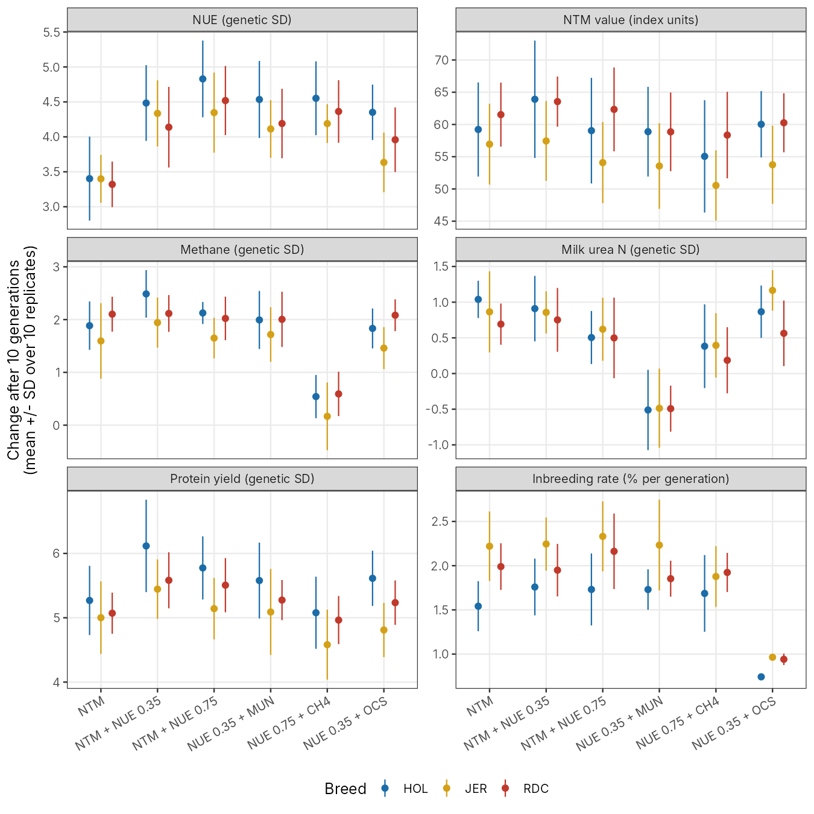
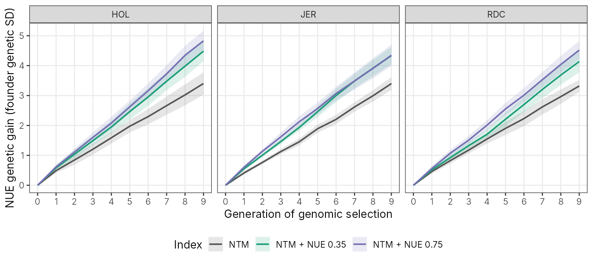
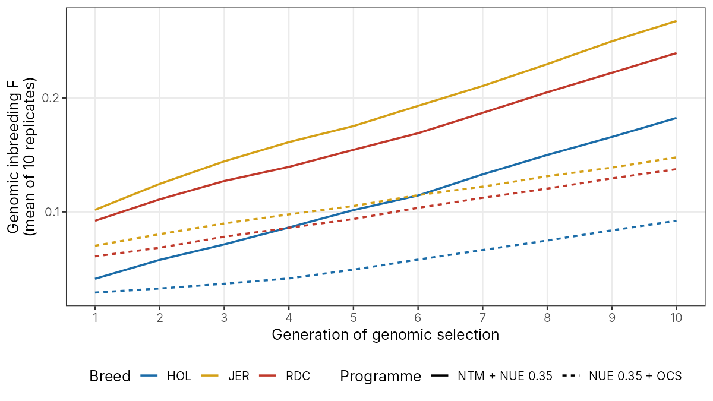

# Responses and trade-offs {#sec-results}

::: {.lead}
This chapter shows what each programme achieved over the selection period, averaged over 10 replicates with independent founder populations. Responses are in genetic standard deviations of the founder population, except NTM value (index units) and the rate of inbreeding (% per generation).
:::

## All scenarios side by side

{#fig-response}

Mean responses per breed:



## NUE over time

{#fig-trend}

## What the figures show

1. **NTM alone already raises NUE** (by 3.3 to 3.4 SD), carried by protein yield, whose genetic correlation with NUE is 0.80.
2. **An NUE weight adds more.** At weight 0.35 NUE rises by a further HOL 1.08, JER 0.94 and RDC 0.82 SD.
3. **Methane rises under NTM alone** (HOL 1.89, JER 1.60, RDC 2.10 SD), through its positive genetic correlations with yield. NTM has no methane weight. The methane weight reverses most of this rise.
4. **A milk urea weight lowers milk urea but not NUE.** This agrees with the weak genetic correlation between the two (-0.12).
5. **Optimum contribution selection halves the rate of inbreeding**, from about 1.8 to 2.2% to 0.7 to 1.0% per generation.

{#fig-inbreeding}

::: {.callout-note}
## Simulation and theory agree for NUE
The NUE response relative to NTM alone was compared with selection-index theory. At weight 0.35 they agree closely (HOL 1.32 in the simulation against 1.32 in theory). At 0.75 the simulated gain is smaller than theory, which is consistent with NUE breeding values being less accurate than protein-yield breeding values, whereas theory assumes true breeding values.
:::
