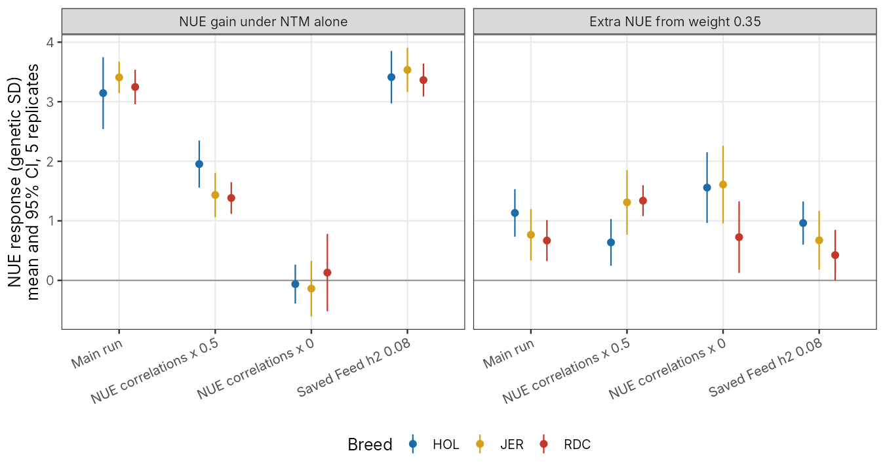

# Sensitivity analyses {#sec-sensitivity}

::: {.lead}
All NUE genetic correlations come from one study of grazing Irish cows. How much do the conclusions depend on them? Three extra sets of runs answer that, each with 5 replicates.
:::

| Set | Change |
|---|---|
| `NUEx0` | Every NUE genetic correlation multiplied by 0 (NUE unrelated to all other traits) |
| `NUEx05` | Every NUE genetic correlation multiplied by 0.5 |
| `SFh008` | Saved Feed heritability 0.08 (the NAV Saved Feed index) instead of 0.23 |

{#fig-sensitivity}

## How to read it

- **Left panel.** As the NUE correlations shrink towards zero, the NUE gain under NTM alone falls to about zero. NTM improves NUE only through those correlations.
- **Right panel.** The extra NUE from an explicit weight stays positive in every set, including when NUE is unrelated to every other trait (HOL +1.56 SD).

::: {.callout-important}
## The conclusion
The recommendation to add an NUE weight does not depend on the uncertain NUE correlations. The statement that NTM already improves NUE does.
:::
